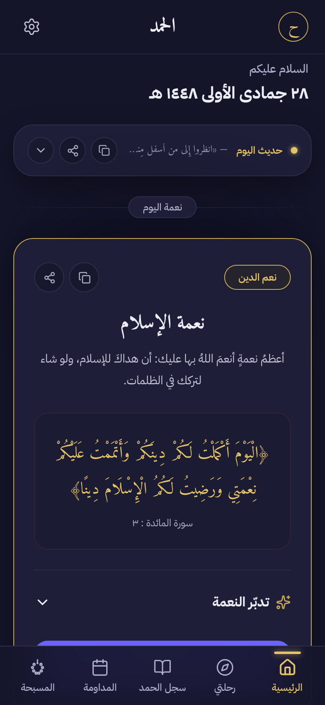
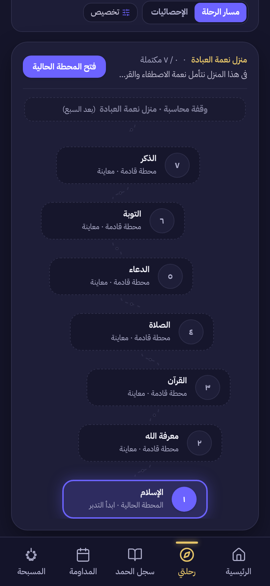
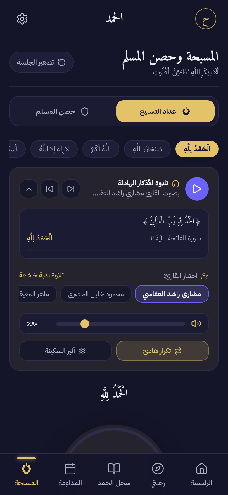
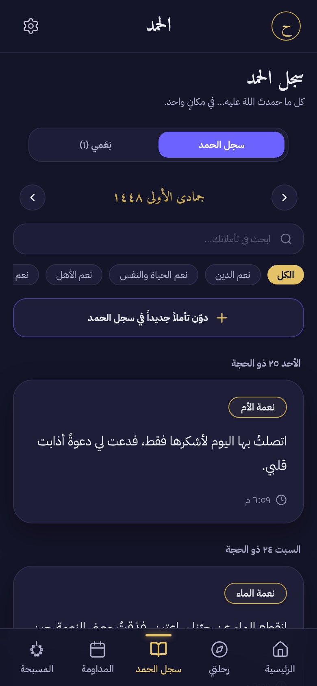
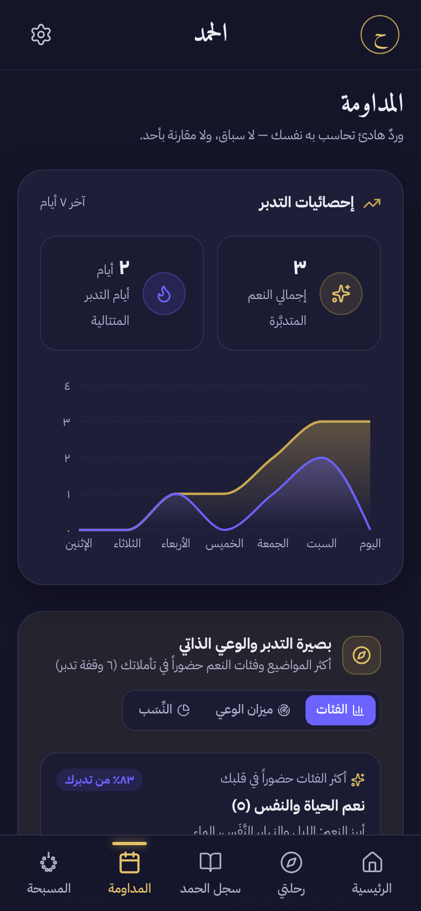
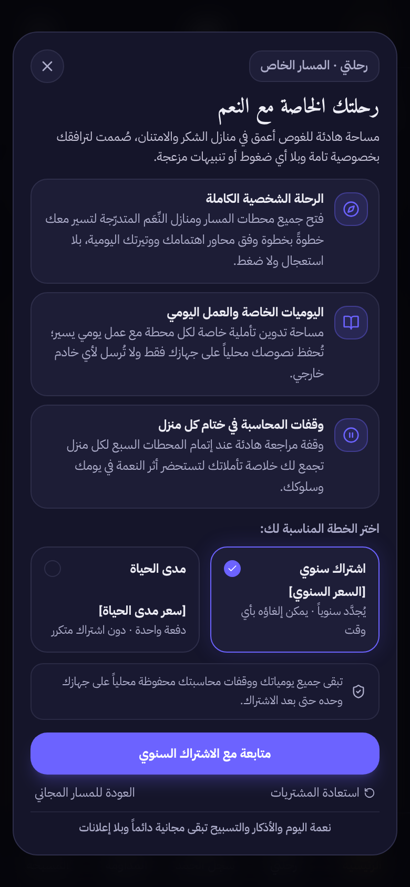

<div align="center">

# الحمد — Alhamd

**A calm, Arabic-first app for noticing and reflecting on God's blessings — one blessing a day, without pressure or streaks.**

[**Live demo**](https://alhamd-wheat.vercel.app) · [Screenshots](#screenshots) · [Tech stack](#tech-stack) · [Architecture](#architecture)


</div>

---

## Overview

Alhamd (الحمد, "All praise") is a mobile-first, right-to-left web app for daily gratitude in an Islamic context. Each day it presents a single blessing (*ni'mah*) with a Qur'anic verse, a short reflection, and a private journal prompt. Around that core it offers adhkar (Hisn Al-Muslim), a tasbih counter with recitation audio, a Hijri calendar, shareable image cards, and a premium guided journey.

It is built **local-first and privacy-first**: there are no accounts and no server. All user data — journal entries, reflections, progress, and settings — stays in the user's browser.

## Screenshots

| Today's blessing | My Journey (premium) | Tasbih & audio |
|:---:|:---:|:---:|
|  |  |  |

| Gratitude journal | Consistency & Hijri calendar | Paywall |
|:---:|:---:|:---:|
|  |  |  |

## Features

- **Daily blessing engine** — picks a blessing for each day by date from a curated set of 40, each with a verse, explanation, and reflection.
- **Reflection flow & private journal** — guided reflection, free-form entries, and category charts (Recharts) of what you've been grateful for.
- **Hisn Al-Muslim** — 23 authenticated adhkar across 6 categories (morning, evening, after prayer, sleep, home, distress), with per-day repetition counters and favourites.
- **Tasbih counter + recitation player** — 5 renowned reciters, volume control, calm repeat mode, and a speech-synthesis fallback.
- **Hijri calendar** — Umm al-Qura dates via `Intl.DateTimeFormat`, with no date library.
- **Share cards** — renders 1080×1350 (post) and 1080×1920 (story) images on a `<canvas>`, with custom Arabic word-wrapping.
- **My Journey (premium)** — a guided program of 4 themed stages and 28 stations, with onboarding, pace selection, reminders, weekly self-review (*muhasaba*), and a weekly progress chart.
- **Monetisation-ready** — paywall with annual and lifetime plans behind a single entitlement service designed for a drop-in RevenueCat integration.
- **Personalisation & accessibility** — dark, light, and auto themes; 4 Arabic typefaces; adjustable text size; ARIA labelling throughout; reduced-motion support; haptic feedback; a spotlight onboarding tour.

## Tech stack

| Layer | Choice |
|---|---|
| UI | React 19, TypeScript 5.8 |
| Build | Vite 6, Bun |
| Styling | Tailwind CSS v4, design tokens, CSS custom properties for theming |
| Motion | Motion (Framer Motion) |
| Charts | Recharts |
| Icons | lucide-react |
| Fonts | IBM Plex Sans Arabic, Noto Naskh Arabic, Amiri / Amiri Quran, Tajawal |
| Hosting | Vercel (static) |

## Architecture

```
src/
├── App.tsx                 # Tab shell, modals, onboarding & tour
├── components/
│   ├── screens/            # Home, Journal, Consistency, Tasbih, Hisn, Settings, …
│   ├── journey/            # Premium journey: onboarding, path, station flow, muhasaba, charts
│   ├── layout/             # Top bar, bottom tab bar, desktop nav
│   └── common/             # Share cards, particles, charts, glass cards, spotlight tour
├── lib/
│   ├── store.tsx           # App state (React Context) persisted to localStorage
│   ├── journeyStore.ts     # Journey progression logic and content validation
│   ├── dailyLogic.ts       # Deterministic blessing-of-the-day scheduling
│   ├── hijri.ts            # Umm al-Qura Hijri formatting
│   ├── entitlements.ts     # Premium entitlement service (RevenueCat-ready)
│   └── analytics.ts        # Consent-gated, metadata-only event tracking
├── data/                   # Versioned JSON / TS content (blessings, adhkar, journey)
└── constants/              # Design tokens, strings, categories
```

**Design decisions**

- **Local-first persistence.** State lives in React Context and is saved to `localStorage` under versioned keys (for example `alhamd:journey_state:v1`), so the schema can change without breaking existing users.
- **Privacy by construction.** Analytics are opt-in, and only allow-listed metadata keys (stage ID, station index, plan) are recorded. Journal and reflection text never leaves the device.
- **Content review workflow.** Every authored journey text carries a `reviewStatus` (`pending_review` / `approved`), and sacred text (verses, hadith) is held behind verified tokens until it has been checked word for word.
- **Swappable payments.** UI components only call `isPremium()` and `getEntitlementStatus()`, so a real payment provider can replace the local developer flag without touching any screen.

## By the numbers

- ~13,700 lines of TypeScript/TSX across 52 source files (35+ components)
- 40 blessings · 23 adhkar · 4 journey stages / 28 stations · 5 reciters
- Production bundle: 352 KB JS + 14 KB CSS (gzipped)

## Getting started

Requires [Bun](https://bun.sh) (or Node.js 20+ with npm).

```bash
bun install
bun run dev        # http://localhost:3000
bun run build      # production build to dist/
bun run lint       # type-check with tsc
```

No environment variables are needed to run the app.

## Roadmap

- RevenueCat integration for real in-app purchases
- Code-splitting to reduce the initial bundle
- Native packaging (Capacitor) with local push notifications

## Author

Designed and built by **Adel** — [GitHub @adel3li](https://github.com/adel3li)
