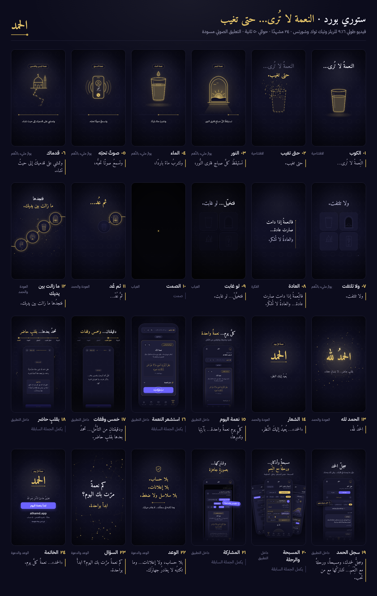

# Alhamd promo video

A 9:16 social ad for the app (Reels, TikTok, Shorts), built from the app's own design system.
Working title: **«النعمة لا تُرى… حتى تغيب»** — a blessing goes unseen until it is gone.

**Status:** idea approved, final script written ([`script.md`](script.md)), motion engine built.
Waiting for the voice file; then `align_voice.py` times every scene to it and `render-motion.cjs` renders the film.



## The idea

We pass through the blessings of an ordinary day (light, water, a voice you love, the feet that carry you),
switch them off for a moment the way the app's guided reflection does, then bring them back so that
«الحمد لله» comes from the heart. Then we show the real app: today's blessing, the five pauses of the
reflection, the journal, tasbih, the journey and sharing, and close on the promise (no account, no ads,
your journal stays on your device) and the call to action.

| Part | Frames |
|---|---|
| Main film (~50 s with a human voice) | `F01`–`F24` |
| Alternative hooks (first 3 seconds) | `HB1–2` «أغمض عينيك», `HC1–2` «كوب الماء», `HD1–2` «عشرون ألف مرّة» |
| Other formats | `COVER` (Reels/TikTok cover), `P45A`, `P45B` (4:5 feed posts) |

Scenes, draft voice-over, motion and sound notes, cut-downs and the open questions are all in
[`storyboard.json`](storyboard.json).

## Layout

```
storyboard.json         scenes, voice-over lines, notes, hooks, formats, cut-downs, the script and its defaults
script.md               the recording script (generated by tools/build_script.py)
script/                 voiceover.txt for Google AI Studio, voiceover.ssml for Cloud TTS, hooks.txt
scenes/
  index.html            renders one still: index.html?f=F01 (add &guides=1 for platform safe zones)
  motion.html           the animated film; driven by motion.js through render-motion.cjs
  scenes.css            tokens from the app's «ليل» theme (src/constants/tokens.ts, src/landing/landing.css)
  art.js                gold line-art: window, glass of water, phone call, footsteps to the mosque, breath
  scenes.js             every scene's layout (shared by the stills and the animation)
  motion.js             every scene's animation as a pure function of time
  app/                  real app screens (3×), captured on 4 Rajab 1448, the day of «نعمة الماء»
tools/
  capture-app-screens.cjs   re-captures app/ (needs `bun run dev` in the repo root)
  render-frames.cjs         stills → out/frames/*.png (1080×1920, 4:5 at 1080×1350)
  timeline.py               scene timing from line lengths (shared by the two below)
  build_animatic.py         timed animatic with a temporary gTTS voice → out/animatic.mp4, out/timings.json
  align_voice.py            splits the real recording into its 19 lines → out/final-timings.json, out/voice-track.wav
  render-motion.cjs         the animated film → out/promo.mp4 (3 parallel renderers, 30 fps)
  sfx.py                    natural sound effects (drop, breeze, vibration, steps, breath, tap), no music
  contact-sheet.cjs         contact sheets → out/contact-sheet-*.png
  build_script.py           script.md and script/ from storyboard.json
  build_page.py             review page → out/page/ (uses page-template.html)
previews/               contact sheets of storyboard v1
```

`out/` is generated and not committed.

## Commands

Run from `marketing/promo-video/`. Needs Node 20+ with Playwright and Chromium, Python 3 with Pillow,
and ffmpeg. Fonts come from Google Fonts, so rendering needs network access.

```bash
node tools/render-frames.cjs          # all stills, or name some: F01 F13
pip install gTTS
python3 tools/build_animatic.py       # temp voice + timings; --silent for no voice
node tools/render-motion.cjs          # animated preview with the temp voice → out/promo.mp4
node tools/render-motion.cjs --at 4.1,25.7   # check single moments → out/motion/at_*.png
node tools/contact-sheet.cjs
python3 tools/build_script.py
python3 tools/build_page.py
```

The gTTS voice is only a guide track for pacing. With the real recording:

```bash
python3 tools/align_voice.py path/to/voice.wav     # or a folder with one file per line
python3 tools/sfx.py out/final-timings.json out/sfx.wav --mix out/voice-track.wav out/mix.wav
node tools/render-motion.cjs --timing out/final-timings.json --audio out/mix.wav --out out/alhamd-promo.mp4
```

## Notes

- Every app screen in the film is a real capture, not a mock.
- The Quranic verse visible in the app screens (Al-Mulk 30) comes from the app's content and should be
  checked word for word before publishing, like the rest of the app's sacred text.
- Amiri mis-stacks the harakat of «نَفَسٍ» at display sizes, which is why the breath hook says «مرّة» / «تتنفّس».
